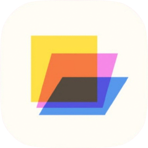

<div align="center">



# Slate

**Universal window tabs for Windows.** Bring any app's window into one tabbed window.

[](https://github.com/burntfern/slate/actions/workflows/ci.yml)
[](https://github.com/burntfern/slate/actions/workflows/release-please.yml)
[](LICENSE)

</div>

Slate turns ordinary top-level windows into tabs. Point it at a browser, an
editor, or a terminal and it hosts that window inside a single host window.
Rather than reparenting with `SetParent`, Slate takes ownership of each window
and moves it to fit the host's content area, so every hosted window keeps its
own process, GPU surface, and input handling. Only the active tab is shown; the
rest stay running and hidden.

## Features

- **Host any window as a tab.** Add one from the `+` picker, Ctrl-drag a window
  onto the host, or hover it in pick mode and press `TAB`.
- **Drag out to detach.** Drag a tab off the strip to send its window back to
  the desktop at the drop point. Works across monitors.
- **Per-tab accents.** Color-code tabs by hue from the tab menu. Session only.
- **Saved sets.** Snapshot the open tabs as a named set and restore it later.
  Restoring only re-hosts windows that are already running; it never launches
  anything.
- **Hover preview.** Rest on a tab for a live snapshot of its window.
- **Global shortcuts.** `Ctrl+Tab`, `Ctrl+Shift+Tab`, `Ctrl+1..9`, and `Ctrl+W`
  keep working while a hosted window has focus.
- **Tray icon.** Restore the host or exit from the notification area.
- **Light and dark themes**, following the system by default.

## Install

Grab the `slate-vX.Y.Z-x86_64-pc-windows-msvc.exe` asset from the
[latest release](https://github.com/burntfern/slate/releases/latest) and run it.
Swap `X.Y.Z` for the version shown there. There is no installer and nothing else
to install.

Releases are unsigned, so SmartScreen may warn on the first launch. To check a
download, compare it against the published `SHA256SUMS`:

```powershell
Get-FileHash .\slate-vX.Y.Z-x86_64-pc-windows-msvc.exe -Algorithm SHA256  # the file you downloaded
```

## Build from source

You need the Rust stable toolchain with the MSVC target and the Windows SDK.

```powershell
cargo build --release -j 1
```

The binary lands in `target\release\slate.exe`. For the development workflow,
see [CONTRIBUTING.md](CONTRIBUTING.md).

## Usage

| Shortcut | Action |
| --- | --- |
| `Ctrl+Tab` / `Ctrl+Shift+Tab` | Next / previous tab |
| `Ctrl+1` … `Ctrl+9` | Jump to the Nth tab |
| `Ctrl+W` | Return the active tab's window to the desktop |
| Ctrl-drag a window onto the host | Add it as a tab |
| Hover a window, then `TAB` | Add it as a tab (pick mode) |
| `Esc` | Cancel pick mode or dismiss a menu |

## Files and data

Slate stores everything under `%USERPROFILE%\.burntfern`:

- `config.json` — theme and accent
- `slate\settings.json` — tab, preview, and shortcut settings
- `slate\sets.json` — saved tab sets
- `slate\logs\` and `slate\backups\` — rotated logs and config backups

On first run each file is seeded from the `configs\` folder that ships next to
the executable (or the working directory in a dev checkout). Deleting these
files resets Slate to defaults.

## Limitations

- **Windows only.** Slate relies on Win32 window ownership, DWM frame control,
  and GDI icon extraction.
- **Owned windows draw above the host.** While a Slate menu or dialog is open, it
  covers the active member. Tooltips and toasts that overlap a hosted window have
  the same problem.
- **No launching, no elevation.** Slate hosts windows that are already running.
  It skips elevated windows unless Slate itself is elevated.

## License

GNU General Public License v3.0. See [LICENSE](LICENSE).

Copyright (C) 2026 burntfern
