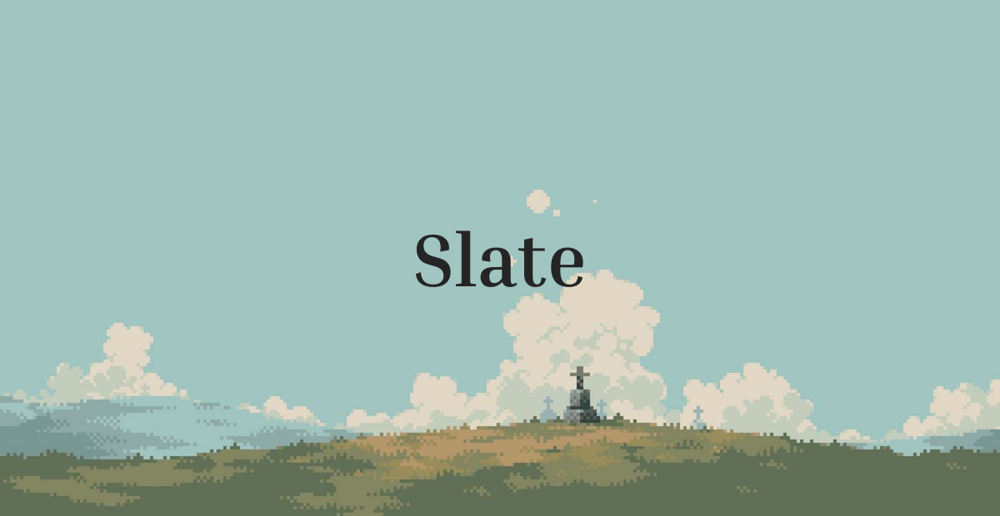

<br/>

<div align="center">

[](https://github.com/burntfern/slate/actions/workflows/ci.yml)
[](https://github.com/burntfern/slate/actions/workflows/release-please.yml)
[](LICENSE)

</div>

`Slate` brings browser-style tabs to every Windows app. Your open windows become tabs in a `single` window, and you switch, add, or detach them with `Ctrl`+`Tab` and a `drag`.

> [!NOTE]
> Slate is in early development and not fully stable yet. Expect bugs and rough edges, and please report anything you run into.

## Features

**`1.`** **Host any window as a tab.** Add one from the `+` picker, Ctrl-drag a window
onto the host, or hover it in pick mode and press `TAB`.

**`2.`** **Drag out to detach.** Drag a tab off the strip to send its window back
to the desktop at the drop point. Works across monitors.

**`3.`** **Per-tab accents.** Color-code tabs by hue from the tab menu. Session
only.

**`4.`** **Saved sets.** Snapshot the open tabs as a named set and restore it
later. Restoring only re-hosts windows that are already running; it never
launches anything.

**`5.`** **Hover preview.** Rest on a tab for a live snapshot of its window.

**`6.`** **Global shortcuts.** `Ctrl+Tab`, `Ctrl+Shift+Tab`, `Ctrl+1..9`, and
`Ctrl+W` keep working while a hosted window has focus.

**`7.`** **Tray icon.** Restore the host or exit from the notification area.

**`8.`** **Light and dark themes**, following the system by default.

## Gallery

<table>
  <tr>
    <td colspan="2" align="center"><code><b>one window, every tab a live window</b></code></td>
  </tr>
  <tr>
    <td colspan="2">
      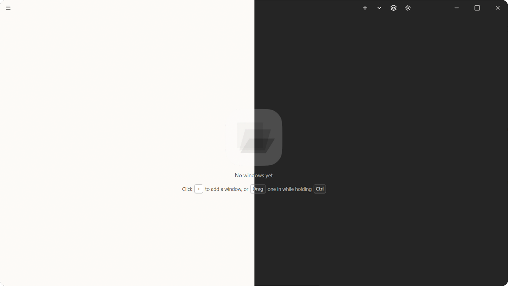
    </td>
  </tr>
  <tr>
    <td width="50%">
      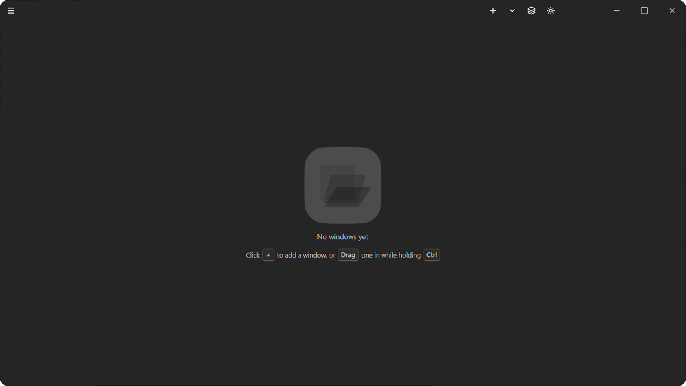
    </td>
    <td width="50%">
      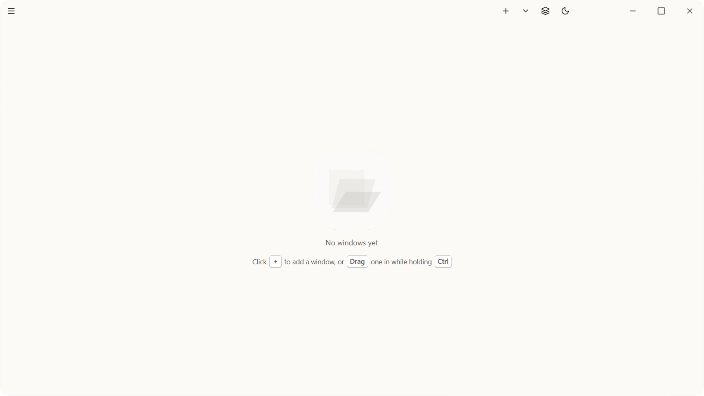
    </td>
  </tr>
  <tr>
    <td colspan="2" align="center"><code><b>tab strip</b></code></td>
  </tr>
  <tr>
    <td colspan="2">
      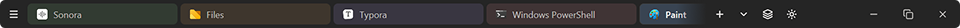
    </td>
  </tr>
  <tr>
    <td colspan="2">
      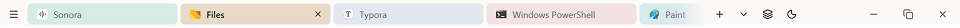
    </td>
  </tr>
  <tr>
    <td colspan="2" align="center"><code><b>overflow</b></code></td>
  </tr>
  <tr>
    <td colspan="2">
      
    </td>
  </tr>
  <tr>
    <td colspan="2">
      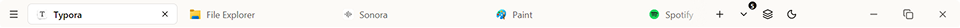
    </td>
  </tr>
  <tr>
    <td colspan="2" align="center"><code><b>hosted apps</b></code></td>
  </tr>
  <tr>
    <td width="50%">
      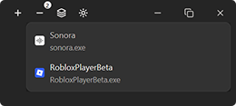
    </td>
    <td width="50%">
      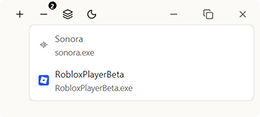
    </td>
  </tr>
  <tr>
    <td colspan="2" align="center"><code><b>pick mode</b></code></td>
  </tr>
  <tr>
    <td width="50%">
      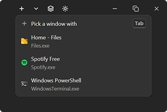
    </td>
    <td width="50%">
      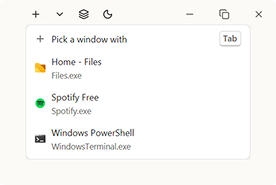
    </td>
  </tr>
  <tr>
    <td colspan="2" align="center"><code><b>saved sets</b></code></td>
  </tr>
  <tr>
    <td width="50%">
      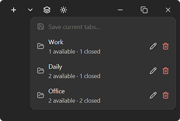
    </td>
    <td width="50%">
      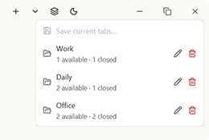
    </td>
  </tr>
  <tr>
    <td colspan="2" align="center"><code><b>game as a tab</b></code></td>
  </tr>
  <tr>
    <td colspan="2">
      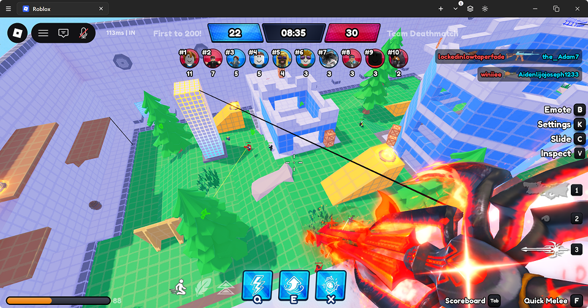
    </td>
  </tr>
</table>

## Install

Grab the `slate-vX.Y.Z-x86_64-pc-windows-msvc.exe` asset from the
[latest release](https://github.com/burntfern/slate/releases/latest) and run it.
Swap `X.Y.Z` for the version shown there. There is no installer and nothing else
to install.

Releases are unsigned, so SmartScreen may warn on the first launch. To check a
download, compare it against the published `SHA256SUMS`:

```powershell
Get-FileHash .\slate-vX.Y.Z-x86_64-pc-windows-msvc.exe -Algorithm SHA256  # the file you downloaded
```

## Build from source

You need the Rust stable toolchain with the MSVC target and the Windows SDK.

```powershell
cargo build --release
```

> [!IMPORTANT]
> The full dependency tree is memory hungry to compile. If cargo fails with `os error 1455` (a paging or commit-limit failure), rerun it with `-j 1` to build one crate at a time.

The binary lands in `target\release\slate.exe`. For the development workflow,
see [CONTRIBUTING.md](CONTRIBUTING.md).

## Usage

| Shortcut                         | Action                                        |
| -------------------------------- | --------------------------------------------- |
| `Ctrl+Tab` / `Ctrl+Shift+Tab`    | Next / previous tab                           |
| `Ctrl+1` … `Ctrl+9`              | Jump to the Nth tab                           |
| `Ctrl+W`                         | Return the active tab's window to the desktop |
| Ctrl-drag a window onto the host | Add it as a tab                               |
| Hover a window, then `TAB`       | Add it as a tab (pick mode)                   |
| `Esc`                            | Cancel pick mode or dismiss a menu            |

## Files and data

Slate stores everything under `%USERPROFILE%\.burntfern`:

- `config.json` - theme and accent
- `slate\settings.json` - tab, preview, and shortcut settings
- `slate\sets.json` - saved tab sets
- `slate\backups\` - timestamped config backups

On first run each file is seeded from the `configs\` folder that ships next to
the executable (or the working directory in a dev checkout). Deleting these
files resets Slate to defaults.

## Limitations

**`1.`** **Windows only.** Slate relies on Win32 window ownership, DWM frame
control, and GDI icon extraction.

**`2.`** **Owned windows draw above the host.** While a Slate menu or dialog is
open, it covers the active member. Tooltips and toasts that overlap a hosted
window have the same problem.

**`3.`** **No launching, no elevation.** Slate hosts windows that are already
running. It skips elevated windows unless Slate itself is elevated.

## License

GNU General Public License v3.0. See [LICENSE](LICENSE).

Copyright (C) 2026 burntfern
